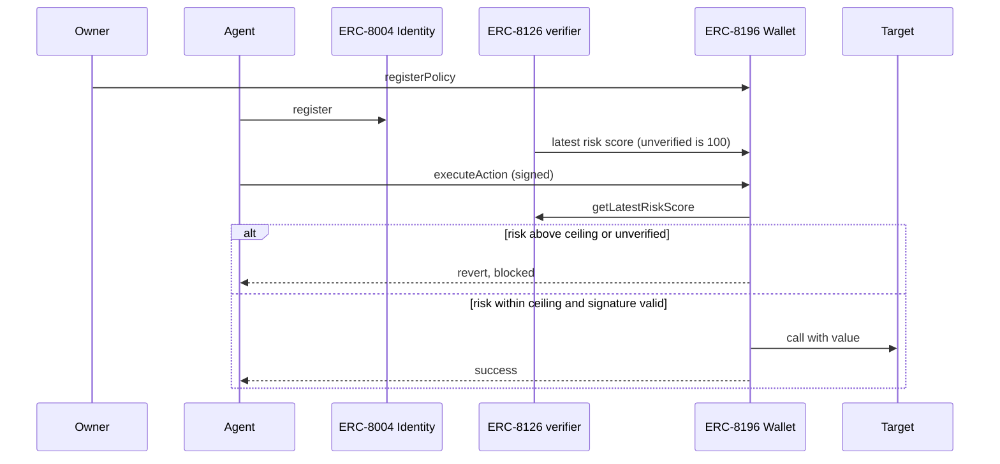

# ERC-8196 Contracts — AI Agent Authenticated Wallet

Solidity for **[ERC-8196](https://eips.ethereum.org/EIPS/eip-8196)** — the execution
layer of the three-tier agent trust stack (**Register** ERC-8004 → **Verify**
ERC-8126 → **Execute** ERC-8196).

> **Status: Draft, interface-first.** ERC-8196 is an Ethereum proposal currently in
> Draft. The **citable artifact is the `IERC8196` interface** — it carries no
> contested design decisions. The full wallet here is a **non-normative reference
> implementation** and may change as the Draft evolves.
>
> Website: [erc8196.ai](https://erc8196.ai) · Authored by Leigh Cronian (@cybercentry) <leigh.cronian@cybercentry.co.uk>, Chris Johnson <chris@virtuals.io>

## Architecture



**Register** (ERC-8004 identity) → **Verify** (ERC-8126 risk score, published on-chain by a
relayer; unverified or stale ⇒ fail-closed at 100) → **Execute** (ERC-8196 wallet enforces
policy + signature + risk ceiling, then logs a hash-chained audit entry).

## The interface (stable artifact)

[`src/interfaces/IERC8196.sol`](src/interfaces/IERC8196.sol) — the functions, events,
errors, and EIP-712 type hashes other implementations and integrators (ERC-8004,
ERC-8126, ERC-4337) should align against:

```solidity
function registerPolicy(
    address agent, string[] calldata allowedActions,
    address[] calldata allowedContracts, address[] calldata blockedContracts,
    uint256 maxValuePerTx, uint256 maxValuePerDay,
    uint256 validAfter, uint256 validUntil, uint8 minVerificationScore
) external returns (bytes32 policyHash);

function executeAction(
    bytes32 policyHash, address target, uint256 value, bytes calldata data,
    uint256 nonce, bytes32 entropyCommitment, bytes calldata signature
) external returns (bool success, bytes32 auditEntryId);

function revokePolicy(bytes32 policyHash, string calldata reason) external;
function getPolicy(bytes32 policyHash) external view returns (
    address agent, address owner, uint256 maxValuePerTx, uint256 validUntil, bool isActive
);
```

## Reference implementation (non-normative)

| Path | Purpose |
|---|---|
| `src/interfaces/IERC8196.sol` | **The interface** — stable, citable |
| `src/ERC8196Wallet.sol` | Reference wallet: policy enforcement, EIP-712 auth, value/temporal/allowlist checks, nonce replay protection, ERC-8126 score gating, hash-chained audit |
| `src/interfaces/IERC8004Identity.sol` | Consumed subset of the ERC-8004 Identity Registry |
| `src/interfaces/IERC8004Validation.sol` | Consumed subset of the ERC-8004 Validation Registry |
| `src/interfaces/IERC8126.sol` | On-chain query surface for the ERC-8126 verifier |
| `src/libraries/PolicyTypes.sol` | Policy and daily-spend storage types |
| `src/ERC8126ScoreAnchor.sol` | On-chain risk-score store (the bridge's on-chain half): admin/oracle role split, fail-closed, 24h TTL |
| `src/ValidationRegistryAdapter.sol` | Drop-in verifier that reads scores from the canonical ERC-8004 Validation Registry once it is live (same `IERC8126` surface) |
| `script/Deploy.s.sol` · `script/Demo.s.sol` | Deploy script · runnable end-to-end demo |
| `relayer/relay.sh` | Reference off-chain relayer (publishes scores to the anchor) |
| [`SCSVS-compliance.md`](SCSVS-compliance.md) | OWASP SCSVS 0.0.1 verification report |
| [`NOTES.md`](NOTES.md) | Cross-spec polarity convention + documented resolutions of points the Draft leaves open |

## Build & test

```bash
# dependencies live in lib/ (gitignored) — install via forge:
forge install OpenZeppelin/openzeppelin-contracts@v5.1.0
forge install foundry-rs/forge-std
forge build
forge test            # 52 tests across wallet, anchor, adapter, and end-to-end bridge
```

## Run the reference end-to-end

```bash
forge script script/Demo.s.sol -v
```
Prints the full lifecycle on a simulated chain: agent **blocked while unverified**
(risk 100, fail-closed) → relayer publishes risk 15 → agent **allowed**, value moves.

## Deploy + relay (live network)

The functioning path is self-contained — scores live in `ERC8126ScoreAnchor`, written by
an off-chain relayer. (The `ValidationRegistryAdapter` is a drop-in for when the ERC-8004
Validation Registry goes live — same `IERC8126` surface, wallet unchanged.)

```bash
# 1. deploy (anchor + wallet), pointed at a live ERC-8004 Identity Registry
PRIVATE_KEY=0x… IDENTITY_REGISTRY=0x… ANCHOR_ORACLE=0x… \
  forge script script/Deploy.s.sol --rpc-url $RPC_URL --broadcast

# 2. relay a score on-chain (oracle/hot key; production fetches from erc8126scan,
#    treats unverified/NULL as 100, maps scan agent -> ERC-8004 agentId)
RPC_URL=… ANCHOR=0x… ORACLE_KEY=0x… AGENT_ID=1 RISK=15 ./relayer/relay.sh
```

See [`NOTES.md`](NOTES.md) for dependency wiring and the **polarity convention**
(ERC-8126 is Final: the wallet reads the risk score directly via `getLatestRiskScore`
and rejects when it **exceeds** `minVerificationScore` — that field is a max-risk ceiling,
no inversion).

## Copyright

Copyright and related rights waived via [CC0](LICENSE).
